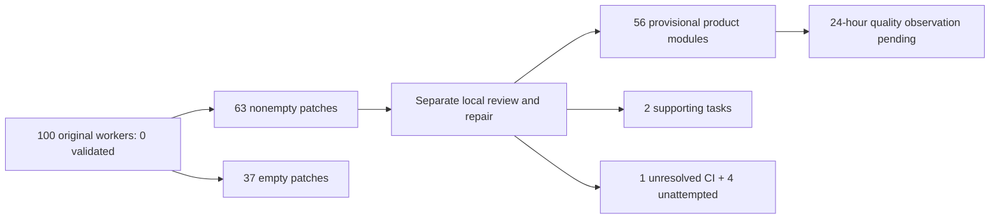
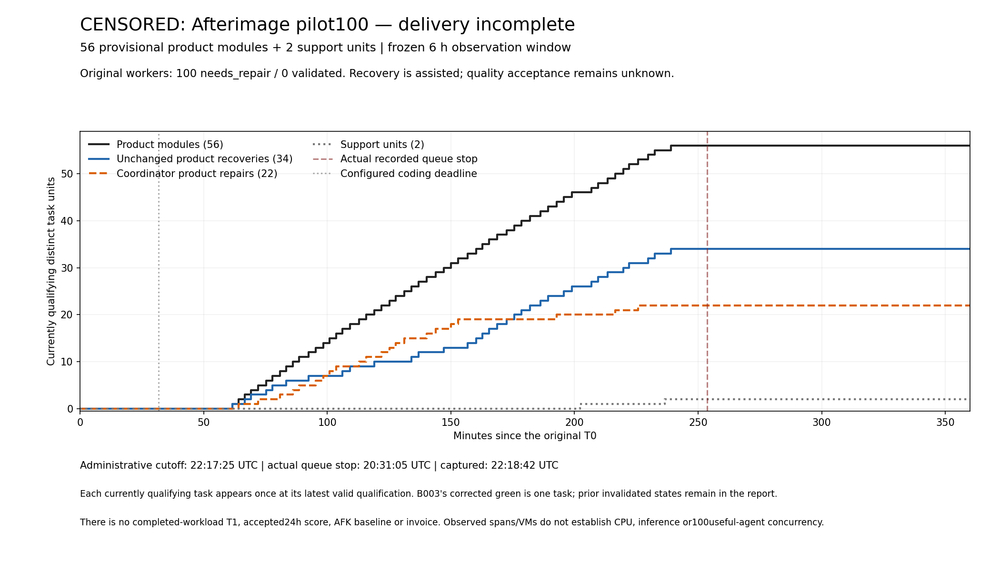

# 100-worker pilot: cutoff-censored recovery — 2026-11-11

**All 100 original workers finished as `needs_repair`; none produced a validated
result.** The cohort recovered 63 nonempty patches and 37 empty patches. A local
recovery stage now reviews usable bytes and attributes coordinator repairs
separately. It does not change original worker outcomes.
[Append-only tracking issue](https://github.com/slgarza/Afterimage/issues/237) and
[machine-readable evidence](pilot100-2026-11-11.json) retain failures and unknowns.

**The six-hour observation ended with recovery incomplete.** At the frozen
`22:17:25.166040 UTC` cutoff, reviewed evidence qualified **56 provisional
product modules and two supporting tasks**. Products comprise 34 unchanged
failed-worker recoveries and 22 coordinator repairs. B096 remained unresolved
in CI, B097–B100 had not been attempted in recovery, and 37 original patches
were empty. The completed-workload T1, quality acceptance, actual cost and AFK
advantage remain unknown.

| Frozen input / limit | Value |
| --- | --- |
| Run | `pilot100-20261111T161645Z-e389f41a` |
| Workload release T0, UTC | `2026-11-11T16:17:25.166040+00:00` |
| Full-delivery cutoff, UTC | `2026-11-11T22:17:25.166040+00:00` (six hours) |
| Worker source | `79404fe6d4ed5cf1b59b5610a3aebbe9d1f8021f` |
| Controller | `979026cbb0d405623c30cdbf4bcf0c9e937bcf01` |
| Requested / admitted workers | 100 synchronized workers, one B task each |
| Coding / sandbox lifecycle | 30 minutes / 45 minutes |
| Quality observation | 24 hours after each actual merge; still provisional |

The complete delivery clock includes admission, startup, model work, failures,
queues, independent review, local repairs, serial credentialed integration,
exact-head CI and final combined checks. Original worker termination does not
stop that clock while recovery/integration continues.

The setup-inclusive view also retains work before release. The separately
instrumented authorized setup ran from `15:46:33.912825Z` to
`16:01:24.298738Z` (890.386 seconds), including overlapping coordination. Its
measured operations include gateway deployment (11.683 seconds), the image-build
request (1.568 seconds; new-layer/cache outcome unverified), one compatibility
probe (39.781 seconds around a 38.936-second agent session), and the post-setup
preflight (66.896 seconds). See the [setup report](setup100-2026-11-11.md) and
[JSON receipts](setup100-2026-11-11.json). These operation times overlap or nest;
they are not additive effort. Earlier design, controller and backlog preparation
did not have a complete recorded historical start. That start, total
setup-inclusive elapsed time and setup-inclusive throughput therefore remain
`null`. Unpartitioned time before T0 is not assumed to be zero. The primary completed-rate definition requires the entire release-to-final-green
clock, including later recovery and CI. This censored observation has no completed
primary delivery rate.

## Cutoff and incomplete delivery clock

The authoritative observation is **CENSORED**, rather than a completed backlog.
The actual queue process stopped at `20:31:05.027569 UTC` while B096 was waiting
for authoritative CI. That was an operator interruption before the deadline,
not a code-failure or cutoff receipt. A separate bounded observer continued
through its last response at `22:17:23.540147 UTC`: no required checks were
returned for B096's new exact head. This sampled response does not establish
CI state at the exact cutoff or a platform outage.

The cutoff sidecar was captured at `22:18:42.590305 UTC`, after the frozen
six-hour endpoint. It preserves the actual 59 queue records and does not invent
100 terminal recovery records or an OS process stop at the cutoff. T1 and
completed-delivery elapsed time remain `null`; the 21,600-second frozen
observation window is separately recorded. The original release clock was
never restarted for review, repairs or CI waits.

The [cutoff sidecar](evidence/pilot100-2026-11-11/censored-observation-close.json),
[stable-source proof](evidence/pilot100-2026-11-11/censored-source-stability-proof.json)
and [artifact validation](evidence/pilot100-2026-11-11/censored-artifact-validation.json)
retain the classification, actual queue state and independently hashed source
inputs. The [actual censor/observer methods](methods/pilot100/censored-observation/README.md)
publish the original offline analysis and inert observer source separately from
the worker/controller release; their 15 synthetic tests authorize no replay.

Over that window, the descriptive censored observation is **56 provisional
products / six hours = 9.333 products per observation hour**; the two supporting
tasks are excluded. This is not accepted throughput, a completed-backlog rate,
or a comparison with an AFK baseline. Accepted PR/hour and every dollar rate
remain `null`. All 100 original controller outcomes remain failures.

## Original worker results

The reviewed terminal snapshot at `2026-11-11T16:53:39.811191+00:00` contains one
row for each B001–B100, including status, exit codes, timestamps, patch/report
hashes, changed paths and sandbox termination. Those 100 safe rows are published
in the JSON report; raw logs and runtime state remain private. The
[provider series](evidence/pilot100-2026-11-11/provider-resource-series.json) and
[activity analysis](evidence/pilot100-2026-11-11/activity-and-overhead.json)
publish reviewed counts, timestamps, source hashes and measurement limits.

| Observation | Count |
| --- | ---: |
| Original validated / independently accepted results | 0 / 0 |
| Original `needs_repair` reports | 100 |
| Nonempty / empty recovered patches | 63 / 37 |
| Exit −1; durations consistent with coding deadline, cause unestablished | 98 |
| Exit 137; cause not established | 1 |
| Exit 0 with empty patch (B094) | 1 |
| Helper check exit 0 / exit 1 | 86 / 14 |
| Worker sandboxes terminated / artifact recovery errors | 100 / 0 |

The earlier “98 timeouts” label was an inference. The deployed driver records
`process.returncode` after waiting and configures a 1,800-second execution limit,
but it does not preserve an explicit terminal-reason receipt. Reported durations
are consistent with that limit; individual timeout/kill causes are not independently
established. Exit137 for B074 likewise has no established cause. Raw exit codes
and original failure outcomes remain unchanged.

A green helper check can include unchanged baseline tests; it is not evidence
that the requested feature was implemented. B094 delivered no source patch after
raising an ambiguity about bounded text fields in its frozen contract. Its
handoff and standard artifacts were recovered, but an additional VM-local custom
receipt cited in that handoff was outside the artifact collection list and was
not recovered. It receives no feature or support delivery credit.

Actual execution was observed: the first complete provider sample at
`16:19:09.534022Z` contained 100 distinct started worker sandboxes. A typed activity
sample at `16:22:29.237745Z` contained 100 distinct thread starts, 100 agents with
command events and 100 reported active spans. These are sampled process/event
observations; they do not establish uninterrupted useful work, concurrent model
inference, 100 accepted contributors or the contest scale requirement. The full
final public provider series contains 240 discrete samples from `16:19:09Z` through
`17:18:55Z`: 92 samples observed 100 worker VMs (first `16:19:09.534022Z`,
last `16:41:54.742696Z`). The first observed zero-VM/zero-container sample after
gateway stop was `16:53:10.358315Z`. These sample counts are not continuous
useful-work durations. The bounded one-hour provider sampler then exited
naturally.

An offline activity audit found completed command events and verified provider
responses for all 100 tasks, with 1,104 completed command items total. A
nonexclusive string heuristic classified 940 commands as canonical-document
read-like; this is a diagnostic classification, not a semantic account of work.
All 100 process envelopes overlap for 1,343.338 seconds; their first-to-last
command envelopes overlap for 853.667 seconds. These envelopes contain idle,
model and queue gaps. Matched receipt-time intervals for completed shell commands overlap at an
observed peak of seven distinct tasks, excluding two unmatched starts. This is
not a provider-timed execution-concurrency metric or an upper bound on actual
activity; remote buffering and clock latency remain unmeasured.
Actual model-request intervals/latencies and per-request queue wait remain
unmeasured. The safe 100-row diagnostic and method hashes are included in JSON.

The configured gateway pacing queue also expired for B063. This was a local
300-second admission-wait expiry, with an existing bounded client retry; it was
not an observed upstream API rate-limit error. Its conservative post-reservation
allowance was retained. Repeated document reads and queue waits are observed;
their contribution to the overall failure is a hypothesis requiring analysis.

## Separate local recovery

Independent UI review covered all 25 nonempty B001–B050 original patches:
After a recorded review correction, 10 are recommended for trusted validation
and 15 rejected. Current recommendations cover B010, B011, B014, B015, B023,
B032, B039, B044, B048 and B049.
Rejections identify missing tests, media failure fallback, test/type errors,
neutral visual-contract deviations or unresolved validation failure. Original
reports and rejection receipts remain unchanged.

The independent reviewer initially accepted subtle blue-tinted chrome while
rejecting more visible blue/cyan controls. The frozen source requires strict
monochrome and provides no intensity tolerance. A full palette audit revoked
B008/B050 recommendations and recorded the same post-merge defect in B003.
Earlier receipts were archived unchanged; the
[append-only correction](https://github.com/slgarza/Afterimage/issues/237#issuecomment-6802311487)
records the review error. Canonical-neutral CSS repairs require separate review,
validation and integration without extra feature credit.

Those first 25 reviews measured 662.547 seconds total, including reading/reporting and
a context resume. This is measured elapsed review evidence, not exclusive
attention or CPU time. Domain/client patches have a separate independent reviewer;
38 nonempty domain/client candidates were reviewed separately: 31 unchanged and seven coordinator-repaired candidates. These are candidate classifications, not extra delivery units.

Domain fixture preparation occurred **during the live cohort after T0**. A
shared segment from `16:29:40.580041Z` to `16:32:23.910653Z` measured 163.331
seconds, before the domain reviewer received or inspected patches; earlier reading
and the first 20 fixtures have no complete duration. The first observed fixture
mtime, `16:27:41.083195Z`, is not proof of creation. These fixtures were not all
preregistered before launch. The [independent acceptance methods](methods/pilot100/independent-acceptance/README.md)
publish all 50 fixture scripts and the portable harness as hash-bound JSON.
Harness corrections at `16:58–16:59Z` and B072/B088 expectation corrections at
`17:04Z`/`17:09Z` occurred after outputs. The original instruments, revocations
and corrected retests are retained. Thirty-eight original-source fixture
executions passed 1,706 canonical assertions, including corrected retests once;
12 empty-source cases were not executed. Fixture success does not establish
strict project checks, owned regression tests, a merge or browser integration.
All preparation and correction stages remain on the original delivery clock.

The coordinator separately repaired two test-only B003 lines. Scoped tests
passed (six tests, 2.435 seconds), and full local validation passed in 42.811
seconds. Independent review approved the new candidate. [B003 PR #239](https://github.com/slgarza/Afterimage/pull/239)
merged at `17:06:51Z` with exact-head checks and
[combined main CI](https://github.com/slgarza/Afterimage/actions/runs/43064951251/job/130677298104)
green (observed `17:08:32Z`). Its 24-hour quality window ends no earlier than
`2026-11-12T17:06:51Z`. The original B003 patch and failure remain rejected;
component and style implementation bytes were unchanged in PR239. A later audit
detected a visual-contract defect, preserved in the history and corrected by
separate PR241 below. This remains coordinator recovery work, not a successful
original worker.

After that successful remote merge, the coordinator encountered a local policy
mismatch from selecting the historical accounting profile. Read-only GitHub
reconciliation verified the actual head, tested/merged tree and main; no second
merge attempt or ledger reset/refund occurred. A read-only policy compatibility
guard was added before subsequent remote writes. The failed local claim is
retained beside the separate manual recovery record.

A separate B003 CSS-only corrective candidate now replaces the four tinted chrome
values with neutral RGB values. Its full local benchmark passed in 45.274 seconds
and independent review approved the exact candidate in 35.687 seconds. [Corrective PR #241](https://github.com/slgarza/Afterimage/pull/241) merged at
`17:19:49Z` with two exact-head checks and
[combined main CI](https://github.com/slgarza/Afterimage/actions/runs/43067097665/job/130684864998)
green (completed `17:21:27Z`; independent read-back `17:29:11Z`). The defect is
corrected but still provisional: the latest 24-hour window runs through at least
`2026-11-12T17:19:49Z`. PR239 plus PR241 count as one B003 item, with no extra
feature credit for the correction.

Independent UI candidate review is now complete: the 10 unchanged candidates
above and 15 separately reviewed coordinator repairs cover all 25 nonempty UI
patches. The other 25 UI patches are empty and remain unimplemented. Repairs
include narrowly scoped test/type/fixture corrections, media error fallbacks
and neutral chrome fixes. The 16 repair-attempt reviews, including B003's
initial and corrective attempts, measured 691.362 seconds; they include reading,
reporting and incoming steering and are not additive to parallel authoring or
the delivery wall clock. The reviewer did not author game repairs. Across both
review lanes, the coordinator's closing authoring record contains 63 candidates:
41 unchanged and 22 repaired. Those candidates are not 63 merged deliveries.

Five further coordinator CSS-only repair candidates passed full local validation
and independent review: B008 (54.578 seconds validation /19.103 review),
B026 (42.130 /24.877), B033 (40.908 /21.089), B035 (43.968 /19.645),
and B050 (43.096 /19.055). Their component logic, markup and owned tests remain
byte-identical to the original recovered patches; original worker failures and
rejections are retained. Exact hash bindings and review timings appear in the
JSON report. Their local validation measurements remain separate from the merged/CI qualification recorded below.

The extended palette audit covered all 25 original nonempty UI patches, including
failed checks and missing-test cases. Seventeen have monochrome authored chrome;
eight require correction (B003, B008, B026, B033, B035, B036, B046, B050).
No further unrecognized palette cases appeared. The audit inspected owned CSS
and non-test inline styles; supplied expressive media remained exempt.

Review approval alone is not delivery. Trusted validation, independent
acceptance, reviewed patch/hash bindings, actual PR merge/tree identity and
exact-head plus combined CI are required. The reviewed cutoff observation
qualifies **58 distinct provisional task units: 56 products plus two support**.
B003 PR239 and corrective PR241 count once. Original failures and the known
post-merge visual defect remain preserved. No replacement paid worker or extra
probe ran.

Product attribution is 34 unchanged recovered implementations and 22 coordinator
code/test repairs. The two supporting tasks, B077 and B090, use unchanged
recovered bytes and are counted apart. B094 is empty and receives no support
credit. B096 receives no credit while its head CI is unresolved; B097–B100 have
nonempty patches but were not attempted in recovery before the cutoff. All
24-hour quality windows remain pending. Earlier snapshots remain historical
records, rather than competing current totals.

The source-bound measurement records 57 local repair/diagnostic validation operations,
including six failures. B046's first coordinator attempt failed full validation
in 26.647 seconds, then a 4.695-second type diagnostic identified missing Node
test ambient types; the corrected candidate passed in 52.107 seconds. The failed
benchmark and archived candidate hashes are verified, while source correspondence
is explicitly a coordinator attestation rather than an independent reexecution.
Both failed B059 attempts (30.570 and 4.467 seconds) also remain preserved.

These are local operation measurements, not worker success counts. Wrapper/check
durations and shared batch work must not be summed as exclusive effort. The JSON
contains per-item PR/CI links, hashes, validation failures, durations and method
provenance; raw commands, logs and runtime/account details remain private.

The [delivery dataset](evidence/pilot100-2026-11-11/delivery-observation-at-cutoff.json),
[integration timing](evidence/pilot100-2026-11-11/integration-timing-cutoff.json) and
[operator methods](methods/pilot100/operators/README.md) make the integration
gates and intervening failures inspectable. The operator export is documentary
v2, with explicit path parameters and formatting changes; it is not a new
controller runtime release. Its synthetic guard tests exercise failure gates,
not game acceptance. The [independent postmortem](evidence/pilot100-2026-11-11/independent-postmortem-public-allowlist.json)
separates nine observations, four unconfirmed causal hypotheses and five
proposed experiments that were not run. Its integration view is explicitly an
interim snapshot. Repeated reads and pacing waits are observations; a definitive
root cause has not been established.

Current [operator measurements](evidence/pilot100-2026-11-11/operator-measurements-cutoff.json)
retain shared review/diagnostic invocations once and mark authoring envelopes as
non-additive. The timing dataset contains 235 operation events. Median wall
times are 0.216 seconds for plan (59 events), 63.201 for prepare (59), 5.839 for
publish (59) and 6.184 for merge (58). The 59 head-wait event observations include
58 passed and one pending, with a raw-event median of 112.588 seconds. This is
neither an all-green nor a distinct-task median. It includes more than runner
execution, and actual runner/API queue time is unknown. These medians and nested
validation durations are not summed as exclusive attention or added to the
already complete T0 observation window.

The [pacing appendix](evidence/pilot100-2026-11-11/pacing-scenario-methodological-appendix.json)
preserves a conditional capacity scenario: reported input may exceed pacing
counts and output caps may be below 4,096. Its 29.66 capacity-minutes upper bound
covers only completed responses; it is neither observed waiting, a wall-time
lower bound nor total demand including failures. Per-request phases are missing.

The [B096 investigation](evidence/pilot100-2026-11-11/B096-ci-stall-investigation.json)
and [coordinated CI-delay appendix](evidence/pilot100-2026-11-11/coordinated-ci-delay.json)
preserve a later exception. Seventeen listed steps in each original workflow
were successful while aggregate checks remained in progress. The waiter stopped
at `20:31:05Z` before cutoff; cancel, rerun and force-cancel requests were
rejected. One lease-guarded commit-metadata retry preserved the exact code tree
and single parent. A first stale post-write GET was reconciled with separate
read-only evidence, without a second push. Its new exact-head checks must
actually succeed before any credit; no outage cause is established and the
original clock includes the entire wait through the frozen observation cutoff.

The [CI-retry reference package](methods/pilot100/ci-retry/README.md) was
approved for export after coordinator review. Its byte-frozen historical state
remains marked held-at-curation. Four inert source templates and 14 offline
guards expose the safeguards without invoking an operator; later real outcomes
belong in the incident appendix rather than rewriting that historical package.

The separately approved [last-observation method](methods/pilot100/ci-last-observation/README.md)
permits one later normal-final observation or an actual-cutoff censored
observation, never both. Censoring does not invent a completed delivery clock,
T1 or 100 terminal queue records. Its 25 offline fixtures preserve the shared
GET budget and distinguish recorded wait-event medians from non-additive,
overlapping waits; runner/API queue time remains unknown.

The [analysis source package](methods/pilot100/analysis/README.md) publishes the
activity analyzer, strict delivery collector, plotter, synthetic tests and
optional plotting dependency lock. The [CI metadata method](methods/pilot100/ci-metadata/README.md)
publishes its bounded read-only collector, synthetic tests, historical source
and retention limitations. These exports expose the measurement algorithms;
they do not execute a new run or publish their private inputs. The last CI observation is separate supporting metadata and cannot manufacture
a completed T1 or a quality-window result.

The [last CI metadata](evidence/pilot100-2026-11-11/ci-metadata/ci-censored-20261111T222148.154960Z.json)
and mandatory [validation](evidence/pilot100-2026-11-11/ci-metadata/ci-censored-last-validation.json)
were collected **after** cutoff, from `22:18:09Z` through `22:21:48Z` (218.799
seconds). They cover 118 commit SHAs and 177 successful Actions check records,
with 120 original response bodies retained privately and hash-verified. Those
are check records, not deliveries or proof of exact-cutoff CI state. The
persistent reader used 181 of 200 GET attempts across both observations; there
was no reset or further capture. Source state remained unchanged during reads,
without an atomic-snapshot claim. The separate bounded B096 observer used 77
attempts under its own recorded authority. No after-cutoff success changes the
censored counts or gives B096 credit without a reviewed merge.

The figure ends at the administrative six-hour cutoff and explicitly retains
CENSORED labeling and unknown completed T1. B003 contributes one item after its
corrective green checks. Reported process envelopes contain gaps; they are not
CPU, inference or continuous useful-agent measurements. Earlier figure attempts
remain preserved privately with their original hashes.
[SVG](figures/pilot100-2026-11-11/pilot100-censored-20261111T221725Z.svg),
[inputs](figures/pilot100-2026-11-11/censored-plot-inputs.json) and
[render receipt](figures/pilot100-2026-11-11/censored-plot-receipt.json) retain provenance.

## Parallel local controller dashboard

During recovery, the owner separately requested a local GUI, approximately
`18:45 UTC`; that request is not an exact recorded authoring start. Later
requests added English copy, configured project/run selection, a public
screenshot gallery and operational safety recommendations. These are parallel
controller capabilities with **zero B task credit**. They do not alter original
worker outcomes, budget history or the live pilot controller at `979026c`.

[Controller PR #6](https://github.com/slgarza/swarm-control/pull/6) contains source
`5ada06cb91914864a28f4e6bdc60a19c5e94c260`. Its two trusted exact-head Actions
completed successfully at `22:23:27Z` and `22:23:32Z`; the PR remained a draft
pending independent runtime review at export. It was not merged into the pilot
runtime. [Reviewed provenance](evidence/pilot100-2026-11-11/dashboard.json) binds
the commit/tree, checks, source-matching wheel and all known failed or superseded
attempts. Earlier v1–v4 artifacts remain preserved with their original hashes.

The current revision passed 332 controller tests in 35.777 seconds, Ruff,
compilation and JavaScript syntax checks. Actual local-browser validation
covered 17 project/run cases in 2.408 seconds and seven gallery/smoke cases in
1.998 seconds, including bookmark reload, rapid selection changes, clearing
previous data for empty projects and 390/320-pixel layouts. Final browser
passes had zero console errors and only localhost page requests. The GUI
reads an explicitly configured catalog and sanitized snapshots; it provides
no worker-launch, credential, budget migration or integration controls.

The public [five-image English gallery](https://github.com/slgarza/swarm-control/blob/5ada06cb91914864a28f4e6bdc60a19c5e94c260/docs/DASHBOARD.md#screenshots)
shows actual historical data from `22:11:43.831143 UTC`: 100 original failures,
zero validated, 56 provisional products and two supporting items, with T1
unknown. The empty example is the real public controller project with no run
evidence, rather than fabricated results. Screenshots distinguish retained
admission reserves, conservative gateway ceilings and unknown invoices. Older
34-item Spanish and 56-product English captures retain their original history;
none is relabeled as final. Total initial authoring time and attributable local
Codex, shared-service and CI costs remain unknown.

## Cost, quality and comparison limits

The cohort reserved USD145 model and USD31 infrastructure. The earlier setup
retained USD0.50 model and USD19 infrastructure admission reservations. Combined
new reservations are USD195.50 within the authorized USD200 envelope; prior
allocations remain preserved. **USD195.50 is not a gross invoice or actual
spend.** Reservations and
conservative gateway ceilings are accounting controls; they are not invoices,
provider credit or reconciled experiment costs. Actual billed model/infrastructure
costs, eligible dollar denominators and PRs/dollar remain `null`. Accounting was
retained with no allowance refund/refill. Setup costs are included as unknown
components of the setup-inclusive economic view, rather than dropped or zeroed.

Local Codex coordination, independent review and repair sessions, shared
services and CI do not yet have reconciled experiment-attributable usage or
invoices. No extra paid workers or probes under this Modal/gateway run were
started during recovery; that does **not** establish zero economic recovery
cost. Gross and contest-eligible totals, dollars per delivery and dollar rates
remain `null` until those components are reconciled and the contest's quoted
internal-token exemption is confirmed for the actual services used.

The final read-only persistent gateway snapshot at `17:15:41.028985Z` reports
1,057 gateway-admitted/reserved request attempts, 963 completed provider responses
and 94 gateway error outcomes. The `requests` and `count_requests` counters
both increment at reservation, before pacing or either upstream HTTP operation;
1,057 is not a verified upstream inference-send or token-count-call total. Actual
total upstream sends remain unknown; the recorded count-error counter is zero. Reported input/output usage is 19,783,115 /497,784 tokens.
Its committed ceiling is USD59.879551 and uncertain retained ceiling
USD36.994815, totaling USD96.874366 maximum charged ceiling with USD0 pending
reservation. These counters are conservative gateway controls, **not billed or
actual spent dollars**. Failed upstream consumption may remain unknown. Gateway
state is stopped. The final read-only inspection performed no additional
settlement or refund; normal request settlement occurred during execution. Request counts do not
establish accepted features, successful workers or concurrent inference.
The [gateway accounting dataset](evidence/pilot100-2026-11-11/gateway-accounting.json)
defines these admission counters and conservative monetary ceilings.

The original gateway application was stopped at `16:53:03Z`. Complete read-only
provider inventories at `2026-11-11T17:13:10.951056Z` observed zero worker
sandboxes and zero function containers. Zero live inputs/backlog is inferred
from the absence of function containers; the gateway was not revived to query
statistics. This is a point-in-time cleanup snapshot, not a continuous-zero
resource guarantee. Actual billed cost stays unknown. Failures, queue waits,
retries, recovery, repairs and cleanup stay on the experiment record.
The [cleanup receipt](evidence/pilot100-2026-11-11/resource-cleanup.json) states
which zero counts were directly observed and which were inferred.

The workload contains 97 product-module candidates and three supporting tasks
(B077, B090, B094), with disjoint ownership. B leaves consume broad A task scope
without duplicate delivery credit; App composition and a complete game remain
separate work. A successful local fixture does not establish browser integration.

This unpaired scale pilot has no matched strong AFK run, no real same-file
collision-repair proof, no completed quality observation and no efficiency win.
The original 100-worker phase failed and recovery remained incomplete at the
six-hour cutoff. The observed assisted products retain their full review, repair,
CI and integration tail; they establish neither autonomous success nor a win
over Codex or a matched AFK pipeline.
